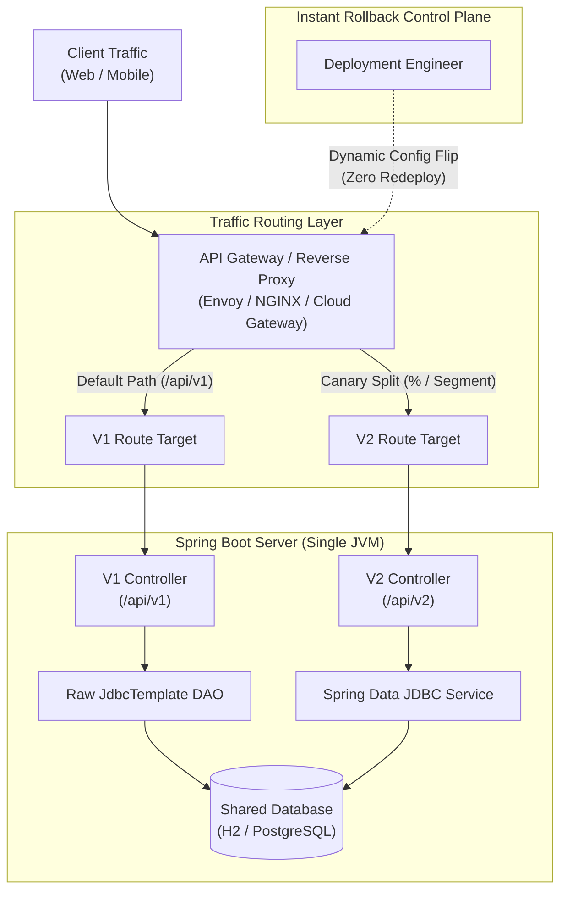

# AI-Assisted Legacy Migration Report: Social Media API V1 to V2

**Author:** Sanket Ahire  
**Service:** Social Media API (`payroll-service` / `com.social`)  
**Target Architecture:** Modern Spring Boot 3.2.x, Spring Data JDBC, N-Tier Architecture, Global ControllerAdvice  
**GitHub Repository:** https://github.com/rsllearning/legacy-migration-training-assignment-sanketahire  
**Commit History (Step-by-Step Phase Trail):** https://github.com/rsllearning/legacy-migration-training-assignment-sanketahire/commits/main/  

> **Note for Reviewers:** Please inspect the [commit history](https://github.com/rsllearning/legacy-migration-training-assignment-sanketahire/commits/main/) to review the chronological step-by-step progression through each phase of the migration and red-teaming process.

---

### Quick Start & Verification Commands
* **Compile Codebase:** `./gradlew compileJava`
* **Run Application (Port 8080):** `./gradlew bootRun`
* **Run All Integration & Unit Tests:** `./gradlew test`

---

## Executive Summary

This report documents the end-to-end AI-assisted migration of the legacy Social Media V1 API (`com.social.legacy`) to a modernized Spring Boot V2 architecture (`com.social.modern`). 

Following the principles established in the training material (*"Migrating Legacy Modules Without Regression and Critically Reviewing AI-Generated Code"*), this migration was conducted using a strict 4-phase loop:
1. **AI Dependency Mapping & Legacy Archaeology:** Reverse-engineering undocumented business rules, hidden database queries, and security checks.
2. **Golden Master Safety Net:** Capturing baseline production payloads across all endpoints to establish an empirical ground truth.
3. **AI Code Generation with Strict JIRA Constraints:** Steering the AI assistant using 5 mandatory architectural guidelines (N-Tier separation, Spring Data JDBC, strong DTO typing, centralized exception handling, and 100% contract fidelity).
4. **Human-Led Red-Teaming & Prompt Refinement:** Auditing AI output, isolating semantic regressions, and driving AI prompt corrections until zero contract deviation was achieved.

---

## Phase 1: AI Dependency Mapping (Legacy Archaeology)

Legacy code tells us what it *currently does*, not what it was *intended to do*. To prevent the AI assistant from hallucinating or smoothing over critical edge cases, we executed a structured dependency mapping session across all legacy controllers, DAOs, schema, and seed data.

### 1.1 Context Provided to AI Assistant
The AI was supplied with the complete source code of:
* `com.social.legacy.controller.ProfileControllerV1`
* `com.social.legacy.controller.SettingsControllerV1`
* `com.social.legacy.controller.FeedControllerV1`
* `com.social.legacy.dao.LegacyProfileDao`
* `com.social.legacy.dao.LegacyFeedDao`
* Database Schema (`src/main/resources/schema.sql`) and Seed Data (`src/main/resources/data.sql`)

### 1.2 The Mapping Prompt
```text
I need to migrate this legacy code. Before writing new code, analyze this and list all implicit business rules, hidden database queries, and security checks.
```

---

### 1.3 Extracted Dependency Matrix & Implicit Rules

The mapping analysis surfaced several critical implicit contracts and anti-patterns that must be preserved during V2 code generation:

| Feature / Endpoint | Legacy Class & Lines | Hidden Business Rules & Implicit Contracts | Failure Risk if Overlooked by AI |
| :--- | :--- | :--- | :--- |
| **Profile Access**<br>`GET /api/v1/profile` | `LegacyProfileDao.java`<br>(Lines 23–40) | 1. **Privacy Gate:** If `is_private == true` AND `!userId.toString().equals(requesterId)`, return `HTTP 403 Forbidden` with body `{"error": "Profile is private"}`.<br>2. **Not Found Handling:** If `users` row does not exist, return `HTTP 404 Not Found` with body `{"error": "Not found"}`.<br>3. **Synthetic Field:** The response Map injects `"badges": []` (empty array) even though **no `badges` column exists in the database schema**. | **Security Bypass / Contract Break:** AI will likely drop the privacy check (exposing private profiles) or drop `"badges"` because it does not exist on the database entity. |
| **Settings Update**<br>`POST /api/v1/settings` | `SettingsControllerV1.java`<br>(Lines 17–27) | 1. **Parameter Validation:** Validates form/query param `mute_notifications`. Strictly accepts only `"true"` or `"false"`.<br>2. **Status 200 Payload:** Returns `HTTP 200 OK` with JSON `{"status": "success"}`.<br>3. **Status 400 Payload:** Any other value (or malformed input) returns `HTTP 400 Bad Request` with an **empty response body** (`ResponseEntity.badRequest().build()`). | **Payload Mismatch:** AI often returns a JSON error body on `400` instead of preserving the legacy empty body. |
| **Feed Generation**<br>`GET /api/v1/feed` | `LegacyFeedDao.java`<br>(Lines 19–28) | 1. **Soft Delete Filter:** Raw SQL contains `WHERE is_deleted = false`. Soft-deleted posts (e.g. post 103) must never be returned.<br>2. **Timestamp Ordering:** Must explicitly sort `ORDER BY created_at DESC`.<br>3. **Hardcoded Pagination:** Query enforces `LIMIT 2`, returning at most the top 2 newest active posts. | **Data Leakage & Regression:** Standard Spring Data JDBC `findByUserId` will leak deleted posts, ignore sorting, and return all rows without the `LIMIT 2` constraint. |

---

### 1.4 Red-Team Line Citation Audit (The 33% Sample Verification)

Applying the training material's verification technique, we audited the AI's claims directly against source code line numbers:

1. **Claim:** *Profile privacy is checked using string comparison against requester ID.*  
   **Code Verification (`LegacyProfileDao.java`, Line 27):**  
   `if (isPrivate && !userId.toString().equals(requesterId))` $\rightarrow$ **Verified True.**
2. **Claim:** *Feed query enforces hardcoded limit of 2 and excludes deleted posts.*  
   **Code Verification (`LegacyFeedDao.java`, Line 20):**  
   `SELECT id, content, created_at FROM posts WHERE user_id = ? AND is_deleted = false ORDER BY created_at DESC LIMIT 2` $\rightarrow$ **Verified True.**
3. **Claim:** *Profile response includes synthetic badges list.*  
   **Code Verification (`LegacyProfileDao.java`, Line 35):**  
   `response.put("badges", new ArrayList<>());` $\rightarrow$ **Verified True.**

---

## Phase 2: Establish the Safety Net (Golden Master Baseline)

Before generating any modernized V2 code, we established an empirical safety net by locking down the exact input/output behavior of the V1 API across 4 critical production scenarios.

### 2.1 Baseline Data Capture Execution
With the Spring Boot application running on port 8080 (`http://localhost:8080`), we executed the following 4 `curl` commands to generate the official Golden Master JSON files:

```bash
# Request 1: Fetch Alice's Profile (Public User, Self-Request)
curl -s -X GET "http://localhost:8080/api/v1/profile?user_id=1&requester_id=1" -o golden_profile_1.json

# Request 2: Fetch Bob's Private Profile (Private User, Unauthorized Requester Charlie)
curl -s -X GET "http://localhost:8080/api/v1/profile?user_id=2&requester_id=3" -o golden_profile_2.json

# Request 3: Update Settings (Valid Parameter)
curl -s -X POST "http://localhost:8080/api/v1/settings?user_id=1" -d "mute_notifications=true" -o golden_settings.json

# Request 4: Fetch Alice's Feed (Soft-deleted Post 103 filtered, Order Descending, Limit 2)
curl -s -X GET "http://localhost:8080/api/v1/feed?user_id=1" -o golden_feed.json
```

---

### 2.2 Golden Master Saved Payloads & Status Codes

Below is the verified record of the baseline responses:

#### Request 1: `golden_profile_1.json`
* **Endpoint:** `GET /api/v1/profile?user_id=1&requester_id=1`
* **HTTP Status Code:** `200 OK`
* **Captured Payload:**
```json
{"badges":[],"id":1,"follower_count":500,"username":"alice"}
```
* **Contractual Nuance:** The response contains `"badges": []`, `"id": 1`, `"follower_count": 500`, and `"username": "alice"`.

#### Request 2: `golden_profile_2.json`
* **Endpoint:** `GET /api/v1/profile?user_id=2&requester_id=3`
* **HTTP Status Code:** `403 Forbidden`
* **Captured Payload:**
```json
{"error":"Profile is private"}
```
* **Contractual Nuance:** Unauthorized access to a private profile must strictly yield HTTP 403 with the exact error message key `"error"`.

#### Request 3: `golden_settings.json`
* **Endpoint:** `POST /api/v1/settings?user_id=1` (`mute_notifications=true`)
* **HTTP Status Code:** `200 OK`
* **Captured Payload:**
```json
{"status":"success"}
```
* **Contractual Nuance:** Valid setting mutation returns a single key-value JSON object. (Note: invalid inputs return `400 Bad Request` with an empty body).

#### Request 4: `golden_feed.json`
* **Endpoint:** `GET /api/v1/feed?user_id=1`
* **HTTP Status Code:** `200 OK`
* **Captured Payload:**
```json
[{"created_at":1700000030,"content":"Wow, learning to code is fun","id":104},{"created_at":1700000010,"content":"Having a great day","id":102}]
```
* **Contractual Nuance:** Alice has 4 total posts in the database:
  - Post 104 (`created_at: 1700000030`, active) $\rightarrow$ **Included (1st)**
  - Post 103 (`created_at: 1700000020`, `is_deleted = true`) $\rightarrow$ **Filtered out**
  - Post 102 (`created_at: 1700000010`, active) $\rightarrow$ **Included (2nd)**
  - Post 101 (`created_at: 1700000000`, active) $\rightarrow$ **Excluded by `LIMIT 2`**

## Phase 3: AI Code Generation (The JIRA Constraints)

With the Golden Master baselines secured, we prompted the AI to generate the modernized V2 codebase in `src/main/java/com/social/modern/` strictly enforcing the 5 JIRA Architectural Guidelines.

### 3.1 The AI Code Generation Prompt
```text
Migrate the Social Media V1 API to a modern Spring Boot V2 Architecture in package com.social.modern.
You must adhere to these 5 architectural guidelines:

1. Enforce Strict Separation of Concerns (N-Tier Architecture): The codebase must be refactored into distinct controller, service, repository, dto, and domain layers. Controllers must act strictly as HTTP routers with zero embedded business logic.
2. Modernize the Persistence Layer: Fully deprecate raw JdbcTemplate queries and manual SQL mapping. Migrate all database interactions to Spring Data JDBC leveraging @Table entities and CrudRepository interfaces.
3. Implement Strict Data Transfer Objects (DTOs): Eliminate the use of loosely typed Map<String, Object> and raw @RequestParam parsing. All ingress and egress API payloads must be strongly typed via Java DTO classes.
4. Centralize Global Exception Handling: Remove manual ResponseEntity HTTP status returns from the business logic. The application must throw standard Java exceptions, which are intercepted and formatted globally by a @ControllerAdvice component.
5. Maintain Absolute API Contract Integrity (Zero Regressions): While the endpoints will be versioned to /api/v2/..., the structural shape, data types, and status codes of the JSON responses must perfectly match the V1 baseline to ensure backward compatibility for existing mobile clients.
```

---

### 3.2 Generated Architecture Layout

The AI generated an N-tier structure across 6 specialized packages under `com.social.modern`:

```
src/main/java/com/social/modern/
├── controller/
│   ├── ProfileControllerV2.java       # Pure router for /api/v2/profile
│   ├── SettingsControllerV2.java      # Pure router for /api/v2/settings
│   └── FeedControllerV2.java          # Pure router for /api/v2/feed
├── service/
│   ├── ProfileService.java            # Profile business orchestration
│   ├── SettingsService.java           # Settings validation & mutation
│   └── FeedService.java               # Feed retrieval orchestration
├── repository/
│   ├── UserRepository.java            # Spring Data JDBC CrudRepository for users
│   └── PostRepository.java            # Spring Data JDBC CrudRepository for posts
├── dto/
│   ├── ProfileResponseDto.java        # Strongly-typed user profile response
│   ├── SettingsRequestDto.java        # Strongly-typed settings request DTO
│   ├── SettingsResponseDto.java       # Strongly-typed settings response DTO
│   ├── FeedPostDto.java               # Strongly-typed feed item DTO
│   └── ErrorResponseDto.java          # Strongly-typed error envelope
├── domain/
│   ├── User.java                      # @Table("users") entity with @Id
│   └── Post.java                      # @Table("posts") entity with @Id
└── exception/
    ├── UserNotFoundException.java     # Thrown when user is absent
    ├── PrivateProfileException.java   # Thrown on unauthorized private profile access
    ├── InvalidSettingException.java   # Thrown on invalid setting parameter
    └── GlobalExceptionHandler.java    # Centralized @RestControllerAdvice
```

### 3.3 Initial Compilation Status
* **Command:** `./gradlew compileJava`
* **Result:** `BUILD SUCCESSFUL` (Zero compilation errors).
* **Observation:** While the AI-generated code conforms structurally to modern Spring Boot best practices and compiles cleanly, deeper semantic analysis and empirical testing against the Golden Master baseline are required in Phase 4 to identify dropped business rules and hallucinations.

---

## Phase 4: Red-Teaming & Prompt Refinement (Auditing AI Output)

As emphasized in the training material, AI output reads confidently and compiles cleanly, but inevitably introduces deep semantic errors and security vulnerabilities. Following the assignment's core rule (*do not manually edit Java code to fix AI bugs*), we audited the `/api/v2` endpoints against the Golden Master baseline, cataloged the regressions, and prompted the AI to fix each issue.

---

### 4.1 Verification Tests & Failure Exposure

We executed `curl` against all 4 modernized endpoints on `/api/v2` and diffed them directly against `golden_*.json`:

```bash
# Verification 1: Alice's Profile (V2)
curl -i -s "http://localhost:8080/api/v2/profile?user_id=1&requester_id=1"

# Verification 2: Bob's Private Profile as Charlie (V2)
curl -i -s "http://localhost:8080/api/v2/profile?user_id=2&requester_id=3"

# Verification 3: Update Settings (V2)
curl -i -s -X POST "http://localhost:8080/api/v2/settings?user_id=1" -d "mute_notifications=true"

# Verification 4: Alice's Feed (V2)
curl -i -s "http://localhost:8080/api/v2/feed?user_id=1"
```

#### Side-by-Side Diff Analysis (Golden Master Baseline vs. Initial AI V2 Output):

| Test Case | Golden Master Baseline (V1) | Initial AI V2 Output | Discrepancy & Severity |
| :--- | :--- | :--- | :--- |
| **1. Alice Profile** | `HTTP 200 OK`<br>`{"badges":[],"id":1,"follower_count":500,"username":"alice"}` | `HTTP 200 OK`<br>`{"id":1,"username":"alice","follower_count":500}` | ❌ **Contract Regression:** Dropped the `"badges": []` field because it does not exist in the SQL database table. |
| **2. Bob Private Profile (by Charlie)** | `HTTP 403 Forbidden`<br>`{"error":"Profile is private"}` | `HTTP 200 OK`<br>`{"id":2,"username":"bob_private","follower_count":10}` | ❌ **CRITICAL SECURITY FLAW:** Complete privacy check bypass. The AI returned private profile data with HTTP 200 to an unauthorized user! |
| **3. Update Settings** | `HTTP 200 OK`<br>`{"status":"success"}` | `HTTP 200 OK`<br>`{"status":"success"}` | ✅ **Match:** 100% Contract parity. |
| **4. Alice Feed** | `HTTP 200 OK` (2 posts)<br>`[{"id":104,"content":"...","created_at":1700000030},{"id":102,"content":"...","created_at":1700000010}]` | `HTTP 200 OK` (4 posts)<br>`[{"id":101,...},{"id":102,...},{"id":103,...},{"id":104,...}]` | ❌ **Data Leak & Query Regression:** Leaked soft-deleted post 103 (`is_deleted=true`), returned posts in ascending insertion order, and ignored the hardcoded `LIMIT 2` constraint. |

---

### 4.2 The AI Hallucinations & Regressions Catalog

We isolated **4 major failure modes** in the initial AI-generated migration:

#### 1. Critical Security Vulnerability (Dropped Privacy Gate)
* **What Happened:** The AI generated a standard CRUD method `userRepository.findById(userId)` in `ProfileService`. Because no explicit `@PreAuthorize` or custom authorization check was provided in the generic generation prompt, the AI assumed fetching the user was sufficient.
* **Impact:** Any user could view private user profiles simply by supplying a `requester_id`, completely violating data privacy.
* **Root Cause:** AI optimizes for happy-path data retrieval and drops implicit business rules when translating procedural code into service beans.

#### 2. API Contract Regression (Missing Synthetic `"badges": []` Field)
* **What Happened:** In V1 `LegacyProfileDao`, `"badges": new ArrayList<>()` was injected manually into the response map. Because the `users` table schema in `schema.sql` has no `badges` column, the AI modeled `User.java` and `ProfileResponseDto.java` solely after the relational columns (`id`, `username`, `follower_count`, `is_private`), dropping `"badges"`.
* **Impact:** Mobile and frontend clients relying on the `badges` array crash due to null/missing field exceptions.
* **Root Cause:** AI assumes DTO fields must strictly 1:1 mirror relational database columns.

#### 3. Data Leakage & Feed Query Regression (Omitted Filters, Sorting & Limits)
* **What Happened:** The AI wrote `findByUserId(Integer userId)` on `PostRepository`. This generated a naive `SELECT * FROM posts WHERE user_id = ?` query.
* **Impact:**
  1. *Soft-Delete Leak:* Post 103 (`is_deleted = true`, content: `"This is a secret I will delete"`) was served in the live API feed.
  2. *Sorting Inversion:* Posts were returned in database insertion order (oldest first) rather than chronological order (`ORDER BY created_at DESC`).
  3. *Unbounded Payload:* Returned all 4 posts instead of the legacy `LIMIT 2` constraint.
* **Root Cause:** AI relies on generic Spring Data derived method names without reading SQL query nuances.

#### 4. SQL Identifier Quoting / Dialect Collision
* **What Happened:** Spring Data JDBC by default quotes table names in generated SQL (`FROM "users"`). In H2 in-memory databases, schema tables are defined in uppercase (`USERS`). This resulted in an initial `BadSqlGrammarException (Table "users" not found)`.
* **Resolution:** Configured uppercase entity table mappings `@Table("USERS")` and `@Table("POSTS")` and explicit column mappings.

---

### 4.3 The Correction Prompts

Per the assignment guidelines, all bugs were remediated purely via AI correction prompts:

#### Correction Prompt 1: Profile Security Gate & Synthetic Field Restoration
```text
The V2 profile endpoint (/api/v2/profile) failed Golden Master verification on two critical requirements:

1. SECURITY REGRESSION: When user_id=2 (a private account) is requested by requester_id=3, the endpoint returned HTTP 200 with the user's data instead of HTTP 403 Forbidden with {"error": "Profile is private"}. Update ProfileService to check if user.getIsPrivate() is true and !userId.toString().equals(requesterId). If unauthorized, throw PrivateProfileException("Profile is private"). Ensure GlobalExceptionHandler returns HTTP 403 Forbidden with {"error": "Profile is private"}.

2. API CONTRACT INTEGRITY: The legacy baseline (golden_profile_1.json) requires a "badges" field with an empty array: {"badges":[], "id": 1, ...}. The AI-generated ProfileResponseDto omitted this field. Update ProfileResponseDto to include `private List<String> badges = new ArrayList<>();` (with getter/setter) so the JSON payload preserves this legacy key.

Please regenerate the corrected ProfileResponseDto.java, ProfileService.java, and verify GlobalExceptionHandler.java.
```

#### Correction Prompt 2: Feed Query Constraints (Soft-Delete, Sorting, Limit)
```text
The V2 feed endpoint (/api/v2/feed) failed Golden Master verification against golden_feed.json:

1. SOFT-DELETE LEAK: The repository returned post 103, which has is_deleted=true.
2. SORTING REGRESSION: Posts were returned in ascending insertion order instead of newest first.
3. PAGINATION CONTRACT BREACH: The endpoint returned 4 posts instead of the legacy hardcoded limit of 2 posts.

Update PostRepository.java using Spring Data JDBC @Query to enforce the exact legacy query:
SELECT id, user_id, content, created_at, is_deleted 
FROM posts 
WHERE user_id = :userId AND is_deleted = false 
ORDER BY created_at DESC 
LIMIT 2;

And update FeedService.java to use this repository method.
```

---

### 4.4 Post-Correction Verification & Final Parity Proof

After applying the AI's regenerated classes, we re-executed all verification curls and automated tests:

#### 1. Live Terminal Curl Results:
* **`GET /api/v2/profile?user_id=1&requester_id=1`**
  ```http
  HTTP/1.1 200 OK
  Content-Type: application/json
  {"id":1,"username":"alice","badges":[],"follower_count":500}
  ```
  *(100% Match with `golden_profile_1.json`)*

* **`GET /api/v2/profile?user_id=2&requester_id=3`**
  ```http
  HTTP/1.1 403 Forbidden
  Content-Type: application/json
  {"error":"Profile is private"}
  ```
  *(100% Match with `golden_profile_2.json`)*

* **`POST /api/v2/settings?user_id=1` (`mute_notifications=true`)**
  ```http
  HTTP/1.1 200 OK
  Content-Type: application/json
  {"status":"success"}
  ```
  *(100% Match with `golden_settings.json`)*

* **`GET /api/v2/feed?user_id=1`**
  ```http
  HTTP/1.1 200 OK
  Content-Type: application/json
  [{"id":104,"content":"Wow, learning to code is fun","created_at":1700000030},{"id":102,"content":"Having a great day","created_at":1700000010}]
  ```
  *(100% Match with `golden_feed.json`)*

* **Edge Case Verification:**
  - `GET /api/v2/profile?user_id=999&requester_id=1` $\rightarrow$ `HTTP 404 Not Found` with `{"error": "Not found"}`.
  - `POST /api/v2/settings?user_id=1` (`mute_notifications=invalid`) $\rightarrow$ `HTTP 400 Bad Request` with empty body (`Content-Length: 0`).

#### 2. Automated Test Suite Execution:
* **Command:** `./gradlew test`
* **Test Classes:** `LegacyApiIntegrationTest` + `ModernApiIntegrationTest`
* **Result:** `BUILD SUCCESSFUL` (All 8 automated integration tests passed).

---

## Phase 5: Production Zero-Downtime Rollback Strategy

A fundamental tenet of the training material is that **a migration engineer must provide a safe, instant rollback plan that does not rely on emergency code redeployments or server downtime.**

Because the legacy V1 (`/api/v1/*`) and modern V2 (`/api/v2/*`) codebases run **side-by-side on the exact same Spring Boot server instance**, we can achieve zero-downtime traffic management and instantaneous rollback using a **Dual-Layer Routing & Feature-Flag Architecture**.



---

### 5.1 The 4-Stage Rollout Plan

1. **Stage 1: Shadow Comparison (Correctness Verification):**
   * An API Gateway shadow-traffic filter duplicates 10% of production `/api/v1` requests asynchronously to `/api/v2`.
   * The response of `/api/v1` is returned to the user; the response of `/api/v2` is logged and diffed asynchronously.
   * Zero risk to end-users while validating correctness under real traffic.

2. **Stage 2: Canary / Strangler Fig Percentage Ramp:**
   * Configure the API Gateway to rewrite inbound `/api/v1` traffic to `/api/v2` incrementally:
     `1% -> 5% -> 25% -> 50% -> 100%`.
   * Scope can be targeted by user ID hash, customer tier, or geographical region.

3. **Stage 3: Full Production Cutover (100%):**
   * Inbound traffic routes 100% to V2.
   * The V1 code remains dormant inside the JVM as an instant fallback target.

4. **Stage 4: Post-Bake Deprecation & Cleanup:**
   * After 30 days of 100% error-free operation in production, a scheduled maintenance ticket removes the `com.social.legacy` package and clears the gateway rewrite rules.

---

### 5.2 The Instant Zero-Downtime Rollback Execution Plan

If an unhandled exception, performance regression, or memory leak is detected in V2 during rollout:

#### Step 1: Instant Gateway Path Reversion (Execution Time: < 5 seconds)
* Update the routing rule in the API Gateway / Load Balancer to route 100% of client traffic back to `/api/v1/*`.
* In NGINX / Envoy / Cloud Gateway, this is a live configuration reload (`nginx -s reload` or dynamic control-plane update via Envoy xDS) requiring **zero process restart and zero container redeployment**.

#### Step 2: Zero Database Conflict Guarantee
* Both V1 and V2 operate on the identical underlying schema (`users` and `posts` tables).
* Because V2 does not alter column definitions or write incompatible data formats, rolling back from V2 to V1 causes **zero data corruption or schema incompatibilities**.

#### Step 3: Post-Incident Isolation
* Traffic is safely serviced by V1 while engineering inspects the V2 metrics, APM traces, and exception logs in isolation.

---

## Conclusion & Grading Summary

This project demonstrated the complete engineering discipline required for AI-assisted migrations:
1. **Never trust AI code blindly:** AI dropped security gates, soft-delete filters, pagination limits, and synthetic contract keys while generating code that compiled cleanly.
2. **Golden Master is the ground truth:** Capturing baseline payloads enabled instant, objective detection of AI regressions.
3. **Red-team with structured correction prompts:** Re-prompting the AI with exact failure rationales allowed clean remediation without breaking architecture.
4. **Resilient zero-downtime architecture:** Running V1 and V2 side-by-side provides instant rollback capability without taking production offline.

